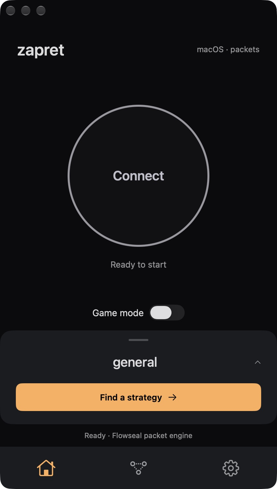
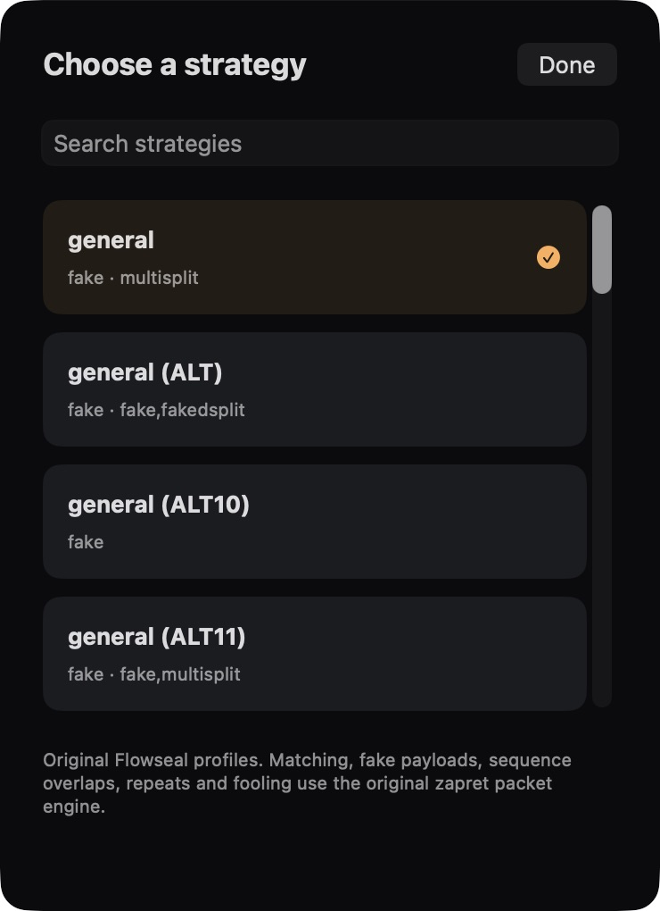

# Zapret macOS

**A native macOS GUI for zapret, using the original Flowseal profiles and bol-van packet engine.**

[Download for Mac](https://github.com/UGamerZ/zapret-discord-youtube-macos/releases/latest) · [Русское руководство](README.md) · [Report an issue](https://github.com/UGamerZ/zapret-discord-youtube-macos/issues/new/choose)

## Features

- All 22 pinned Flowseal profiles, bundled host/IP lists and fake payloads.
- Original C desynchronization engine: TCP/UDP fakes, splitting, sequence overlaps, timestamps and repeats.
- SwiftUI interface inspired by trankesh: Connect, profile picker, Game mode and IPSet.
- Strategy comparison through HTTP probes, packet counters and concrete startup diagnostics.
- One universal app for Apple Silicon and Intel, macOS 13 or later.

<p align="center">
  
  
</p>

## Download and run

1. Open the [latest release](https://github.com/UGamerZ/zapret-discord-youtube-macos/releases/latest).
2. Download **Zapret-macOS-0.2.2-universal.zip**, extract it and move **Zapret macOS.app** to Applications. The automatic “Source code” archives are for developers.
3. Open the app, select `general`, press **Connect** and approve the macOS administrator prompt.
4. Restart browser/Discord connections. Use **Disconnect** or **Quit** to stop interception; closing the window leaves the menu-bar app running.

Xcode, Swift and Python are not needed for the prebuilt app. The app uses ad hoc signing and is not Apple-notarized. macOS may block the first launch; use its standard Privacy & Security approval only if you trust the downloaded build.

To verify the ZIP, download **SHA256SUMS.txt** into the same directory and run:

```sh
shasum -a 256 -c SHA256SUMS.txt
```

## Compatibility and validation

Version 0.2.2 is a regular GitHub release. **The PFLOG/BPF transport remains experimental.** Builds and offline packet tests pass; live privileged interception, crash recovery, Discord voice and ISP bypass have not completed end-to-end validation. HTTP success does not establish working video, voice or DPI bypass.

The adapter needs an Ethernet-compatible physical interface with BPF injection support. Ordinary VPN `utun`, PPP and tunnel interfaces are unsupported. IPv4 and IPv6 default routes must use the same interface. Existing PF rules must reference Apple's `com.apple/*` wildcard anchor.

Administrator access is required while connected. The app does not install a LaunchDaemon, kernel extension or NetworkExtension, and does not change DNS or hosts. It uses no external VPN server. It preserves addresses/ports and calls the original packet engine; it does not replace those methods with a SOCKS proxy.

See [validation](VALIDATION.md), [transport research](PACKET_RESEARCH.md) and the [full Russian guide](README.md) for packet-path details, limitations and recovery instructions.

## Troubleshooting

Use **Copy error** and **Open log** in an error alert. Runtime diagnostics live in `/var/run/zapret-macos-UID/`, with `packet.log` and `status.json`; obtain your numeric UID with `id -u`. Reconnect after changing networks.

[File a bug or network test report](https://github.com/UGamerZ/zapret-discord-youtube-macos/issues/new/choose). Include the macOS version, processor, app version, profile and relevant error. Redact personal paths, identifiers and credentials from logs.

## Build and contribute

Requires Apple Command Line Tools, Swift 5.9+, clang and Python 3. The build uses system libpcap and zlib.

```sh
git clone https://github.com/UGamerZ/zapret-discord-youtube-macos.git
cd zapret-discord-youtube-macos
./scripts/build.sh
./scripts/test.sh
open 'dist/Zapret macOS.app'
```

[Contributing](CONTRIBUTING.md) · [Security](SECURITY.md) · [Changelog](CHANGELOG.md)

## Credits and licensing

Independent, unofficial project. Engine: [bol-van/zapret](https://github.com/bol-van/zapret). Configs/lists/payloads: [Flowseal](https://github.com/Flowseal/zapret-discord-youtube). UI reference/icon/font: [trankesh](https://github.com/trankesh/zapret-youtube-discord-gui).

Project code is [MIT licensed](LICENSE). Third-party notices, exact upstream commits and font licensing are preserved in [THIRD_PARTY.md](THIRD_PARTY.md) and `ThirdParty/`.
